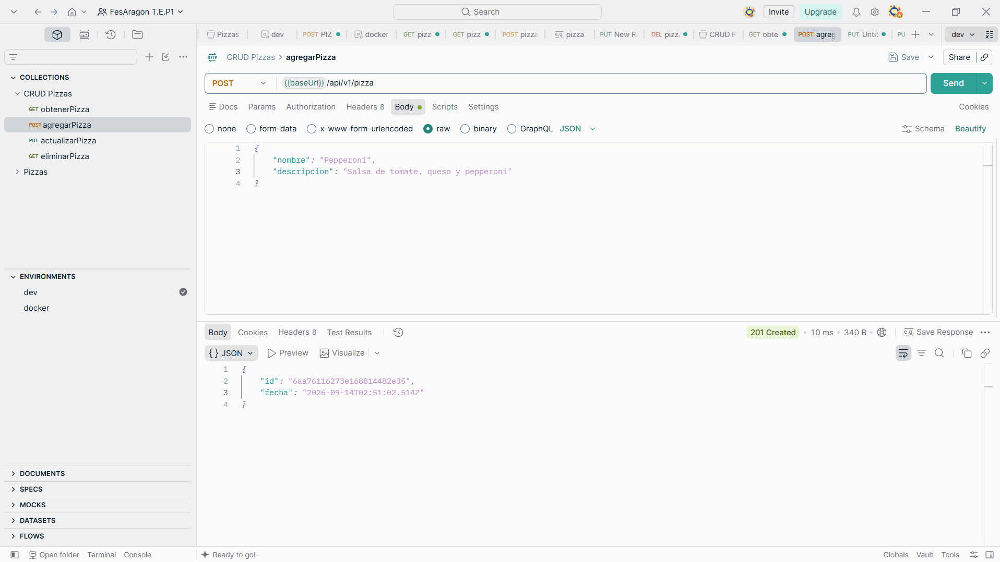
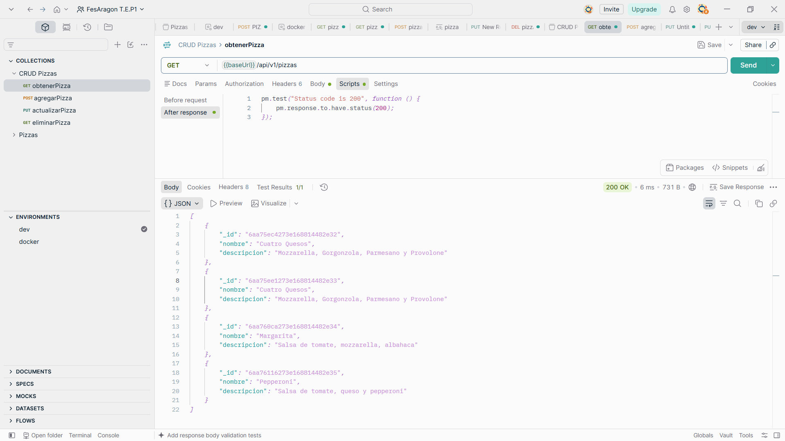
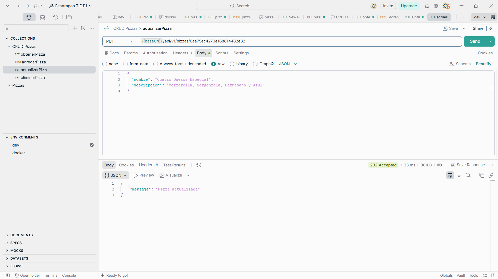
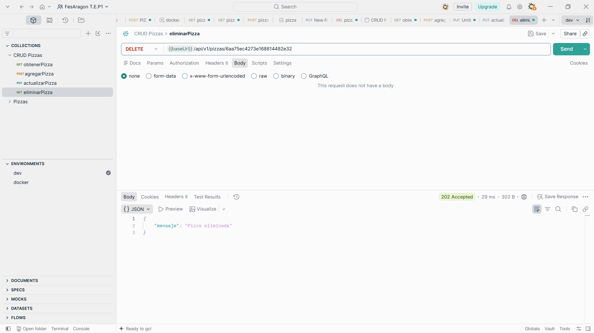
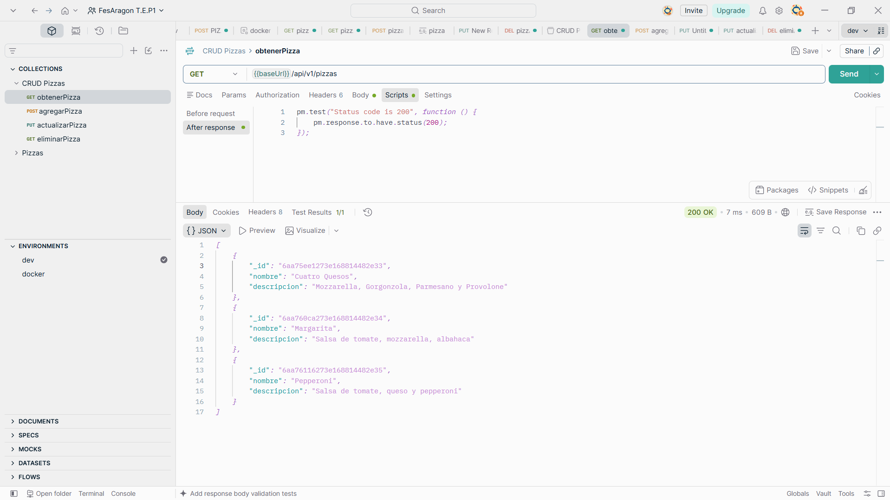

# Servicio RESTful de Pizzas

## Descripción del Proyecto

Este proyecto es un servicio RESTful desarrollado con Node.js y Express para gestionar un CRUD de pizzas. La aplicación fue migrada de una persistencia en memoria a MongoDB, utilizando el driver oficial `mongodb` para almacenar y consultar la información de forma persistente.

La API permite crear, consultar, actualizar y eliminar pizzas mediante endpoints HTTP, siguiendo una separación básica entre las rutas de Express y el repositorio encargado del acceso a datos.

## Configuración e Instalación

### Requisitos previos

- Node.js instalado, preferentemente una versión LTS.
- MongoDB instalado y ejecutándose localmente, o una instancia de MongoDB levantada mediante Docker.
- Postman, opcionalmente, para ejecutar las pruebas de la API.

### Instalar dependencias

Desde la raíz del proyecto, ejecuta:

```bash
npm install
```

### Levantar la aplicación

```bash
node index.js
```

Al iniciar correctamente, el servicio queda disponible en:

```text
http://localhost:3000
```

## Base de Datos

La aplicación utiliza MongoDB como sistema de persistencia.

- Cadena de conexión: `mongodb://localhost:27017`
- Base de datos: `pizzeria`
- Colección: `pizzas`

> Si MongoDB se ejecuta con autenticación, configura las credenciales correspondientes en el módulo de conexión antes de iniciar el servicio.

## Pruebas con Postman

La URL base utilizada para las pruebas es:

```text
http://localhost:3000
```

### Endpoints del CRUD

| Operación | Método | Ruta | Descripción |
| --- | --- | --- | --- |
| Crear pizza | `POST` | `/api/v1/pizza` | Registra una nueva pizza. Envía los datos en formato JSON en el cuerpo de la solicitud. |
| Obtener todas las pizzas | `GET` | `/api/v1/pizzas` | Devuelve la lista completa de pizzas almacenadas. |
| Obtener una pizza | `GET` | `/api/v1/pizzas/:id` | Devuelve una pizza específica usando su identificador de MongoDB. |
| Actualizar una pizza | `PUT` | `/api/v1/pizzas/:id` | Reemplaza los datos de una pizza existente usando su identificador. |
| Eliminar una pizza | `DELETE` | `/api/v1/pizzas/:id` | Elimina una pizza usando su identificador. |

Para las solicitudes `POST` y `PUT`, selecciona **Body > raw > JSON** en Postman. Un ejemplo de cuerpo es:

```json
{
  "nombre": "Pizza Margarita",
  "ingredientes": ["tomate", "mozzarella", "albahaca"],
  "precio": 12.99
}
```

### Importar la colección de pruebas

1. Abre Postman.
2. Selecciona **Import** en la barra lateral o en el menú principal.
3. Elige el archivo de colección de pruebas del proyecto, si está disponible.
4. Confirma la importación.
5. Verifica que las solicitudes utilicen `http://localhost:3000` como URL base.
6. Ejecuta las solicitudes en el orden de creación, consulta, actualización, verificación y eliminación.

## Evidencia de Pruebas

La siguiente sección muestra, en orden lógico, las pruebas realizadas en Postman.

### 1. Crear Pizza (POST)

Se envía una solicitud `POST` a `/api/v1/pizza` con los datos de la pizza en formato JSON. La respuesta confirma la creación y devuelve el identificador generado.



### 2. Obtener Pizzas (GET)

Se consulta `GET /api/v1/pizzas` para comprobar que la pizza creada aparece en la lista de registros.



### 3. Actualizar Pizza (PUT)

Se envía `PUT /api/v1/pizzas/:id` con los nuevos datos para modificar la pizza seleccionada.



### 4. Verificar Actualización (GET)

Se consulta nuevamente la pizza mediante `GET /api/v1/pizzas/:id` para verificar que los cambios fueron guardados correctamente.


### 5. Eliminar Pizza (DELETE)

Se envía `DELETE /api/v1/pizzas/:id` para eliminar la pizza de la colección.



### 6. Verificar Eliminación (GET)

Se realiza una consulta posterior para comprobar el resultado después de eliminar la pizza.



También se reserva el siguiente espacio para una captura general de las pruebas exitosas en Postman:


